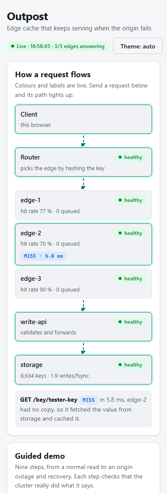

# Outpost

**A fault-tolerant edge/origin request router in C++17.** Outpost puts consistent-hash routing, per-edge
caching, rate limiting and a circuit breaker in front of a small authoritative origin. When the origin fails,
the system degrades instead of falling over: cached reads keep being served, writes are queued durably at the
edge, and everything reconciles, without loss or double-apply, when the origin comes back.


**What's in it**
- **Five core primitives, built by hand** in `common/` with no third-party code: a consistent hash ring, an LRU
  cache, a token bucket, a circuit breaker and a write-ahead log (WAL). The WAL does group commit.
- **Four services:**
  - a stateless **router** on a hash ring;
  - three **edges** with caching, rate limiting, a breaker and a durable write queue;
  - **write-api**, which validates requests;
  - **storage**, a versioned key-value store made durable by its WAL.
- **Standard HTTP caching:** `ETag`, `304 Not Modified`, revalidation with the origin, `stale-if-error`, and a purge
  API.
- **A live dashboard** with a guided nine-step demo of the failure story.
- **Evidence, not claims:** 163 tests, clean ASan/UBSan/TSan runs, a chaos test that kills services under load,
  and k6 benchmarks with the raw results committed.

The services use cpp-httplib, nlohmann/json and spdlog.

## The problem

Systems that serve reads from many edge nodes and send writes to one source of truth usually fail in two ways:

1. **Retry storms turn "slow" into "dead".** When the origin slows down, every edge retries at once, the
   origin gets more load exactly when it can least take it, and the failure cascades.
2. **Naive routing reshuffles everything on scale events.** With `hash(key) % N`, adding or removing one node
   remaps almost every key, so every cache goes cold at the moment you are scaling.

Outpost addresses both:
- A **circuit breaker** per edge stops calling a failing origin and serves cached data instead.
- **Consistent hashing with virtual nodes** moves only about 1/N of the keys when the edge fleet changes.

## Architecture


| Service | Responsibility |
|---|---|
| **router** (8080) | Stateless entry point. Hashes the key onto a ring of healthy edges and forwards the request. Removes an edge after failed health checks and retries once on the new owner. Fans a purge out to every edge. |
| **edge ×3** | Cache-aside reads with a TTL and standard HTTP caching headers, per-client token buckets, a circuit breaker driven by heartbeats, and a write queue in a local WAL. |
| **write-api** | Validates requests; the only client of storage. Healthy only when storage answers. |
| **storage** | The source of truth: a versioned key-value map, durable through its WAL, where concurrent writes share fsyncs. |
| **dashboard** (8090) | Live view of the cluster, a guided demo and request tools (plain HTML/CSS/JS behind nginx). |

### Request flows

**Read path.**
1. The router picks the owning edge for the key and forwards the request: the key percent-encoded, the client
   address in `X-Forwarded-For`, and the client's `If-None-Match` and `Cache-Control`.
2. The edge takes a token from that client's bucket (`429` + `Retry-After` when it is empty).
3. A fresh cached value is a `HIT`.
4. If the client's `If-None-Match` matches the value's ETag, the answer is `304 Not Modified` with no body.
5. A missing value is fetched from write-api while the breaker is CLOSED, cached with its version, and answered
   as `MISS`.
6. An expired value, or any value the client requests with `Cache-Control: no-cache`, is **revalidated**: the
   edge sends the origin its ETag. If the value is unchanged, the origin answers `304`, the edge keeps its copy,
   and the answer is `REVALIDATED`; the value is not sent again.

Every answer that carries a value has these headers:
- `ETag: "<version>-<writerId>"`, the identity of the write that produced the value;
- `Last-Modified`;
- `Age`;
- `Cache-Control: max-age=<remaining ttl>, stale-if-error=3600`.

**Write path.**
1. The edge validates the size and stamps the write with a `(version, writerId)`: microseconds, strictly
   increasing per edge, and the edge's id.
2. While the breaker is CLOSED, it forwards the write (`200`, `X-Write-Mode: DIRECT`, and the write's `ETag`).
3. Storage applies the write only if its version is newer than what it holds.
4. Storage acknowledges the write only once it is in the WAL on disk. Writes that arrive together share one
   fsync (group commit).

**Degraded mode.**
- Every edge heartbeats write-api once a second. Three consecutive failures open the breaker; failed requests
  count too.
- While the breaker is OPEN:
  - the edge sends the origin **no traffic at all**;
  - cached values are served as `X-Cache: STALE`, for up to ttl + `stale-if-error` (1 h by default);
  - writes are appended to the edge's WAL and answered `202 QUEUED`;
  - reads with no usable cached copy answer `503`.

**Recovery.**
1. After 5 s the breaker admits exactly **one** half-open probe. Success closes it.
2. The edge then drains its queue: every write is replayed in order with its **original** version, and only the
   prefix the origin acknowledged is removed from the WAL.
3. Writes queued during the drain are never lost. A replay of a write that already landed is a `duplicate`, and
   a replay that lost to a newer write is `superseded`. Either way it is applied at most once and never
   overwrites newer data.

**Purge.** `POST /purge/key/<k>` on the router asks **every configured edge** to drop the key, including an
edge that is currently off the ring. The answer is `200` when every edge confirmed. When an edge could not be
reached, the answer is `502` with `complete: false`, and the response lists every edge's answer.

More detail: [docs/architecture.md](docs/architecture.md); edge stats contract:
[docs/statsApi.md](docs/statsApi.md). The long-form explanation of every module, decision and bug is
[docs/designWalkthrough.md](docs/designWalkthrough.md).

## Design decisions and trade-offs

- **AP/BASE, not ACID.**
  - **Choice:** during an origin outage Outpost chooses availability. Edges serve stale data and accept writes
    they cannot commit yet.
  - **Convergence:** values converge once the origin returns, through versioned last-writer-wins. Caches are
    refreshed within `CACHE_TTL_MS` (60 s).
  - **Cost:** a client can read a value that has since been overwritten elsewhere, and two concurrent writers
    are ordered by edge clocks (same host here; NTP across hosts).
- **A write-ahead log, hand-built.**
  - **Use:** both the storage service and every edge queue use `common/wal`. Each record carries a magic
    number, a CRC over its length and payload, a sequence number, the write's version and writer.
  - **Recovery:** on open it keeps every valid record, skips a damaged middle record, and truncates only a torn
    tail.
- **Group commit, with no added delay.**
  - **How it works:** a writer appends its record. If no fsync is running, it becomes the *leader*: it fsyncs
    everything written so far, with the lock released so others can keep appending. Writers that arrive
    meanwhile wait for the next fsync instead of each paying for their own. Storage no longer holds its map
    lock across the fsync, so writes can overlap at all. The map only ever holds data that is already durable.
  - **Result:** at the same load, PUT p50 went from 113.90 to 7.90 ms (see Results).
  - **Trade-off:** there is no batching window, so a lone write is never delayed, but writes only share a fsync
    when they overlap. Measured: 2.99 writes per fsync under heavy write load, 1.05–1.33 under light load.
  - **Failure rule:** a failed fsync marks the log failed and every later write is refused. The kernel may
    already have dropped the data, so retrying could report a write as durable when it is not.
- **Versioned writes: idempotency and ordering in one place.** Instead of a separate idempotency-key store,
  storage keeps the `(version, writerId)` of every value. One comparison makes replays idempotent (`duplicate`)
  and prevents stale overwrites (`superseded`), and it is durable because it lives in storage's WAL.
- **Standard HTTP caching instead of custom headers.**
  - **ETag:** it is the write identity `"<version>-<writerId>"`, which every layer already has. Nothing hashes
    a body, and two copies with the same tag are the same write.
  - **What clients get:** `304` saves the body. Revalidation saves the origin from re-sending unchanged
    values. `stale-if-error` puts a written-down bound on how old degraded data can be.
  - **Cost:** writer ids are restricted to `[A-Za-z0-9._-]`, because they become part of a header.
- **Purge goes to every configured edge**, not just those on the ring, because an edge that is briefly off the
  ring may still hold the key.
  - The fan-out is sequential, with each call bounded by the edge timeout.
  - Purge is unauthenticated (trusted network, owner decision).
- **A separate, stateless router.** Clients shouldn't need to know the ring.
  - The router derives the ring from configuration plus health checks and persists nothing.
  - Ownership doesn't depend on insertion order, so a restarted router routes exactly like before.
  - A dead edge leaves the ring, and only its keys move.
- **Consistent hashing with 150 virtual nodes per edge.**
  - Virtual nodes smooth out ownership, but only if the hash spreads similar strings well.
  - Plain FNV-1a gave a 10 / 56 / 34 % split. Adding the MurmurHash3 `fmix64` finalizer gives 32.0 / 36.2 /
    31.9 %.
  - Adding a node now moves 29.3 / 23.0 / 16.4 % of keys (ideal 25 / 20 / 16.7 %).
- **Breaker thresholds: 3 failures, 1 s heartbeat, 5 s reset.**
  - An outage is detected within about 3 s (measured 0.7–3.1 s across runs; failed requests speed it up).
  - During recovery the origin sees a single probe, not a thundering herd.
  - A probe whose result is lost is replaced after the same timeout, so the breaker can't wedge in HALF_OPEN.
  - Lower thresholds react faster but flap on transient errors; higher ones serve errors for longer.
- **Logs go to standard output, not files.**
  - Docker collects them: `docker compose logs -f <service>`.
  - Compose keeps at most 3 × 10 MB per container. `LOG_LEVEL` sets the level.
  - Only state changes and errors are logged, never each request. Per-request counters are in `/debug/stats`.
- **Out of scope:** authentication (trusted network), multi-region routing, deletes (they would need versioned
  tombstones), strong consistency, WAL compaction.

## Quick start

Prerequisites: Docker with Compose v2. For building and testing outside Docker you also need CMake ≥ 3.16 and
a C++17 compiler (tested with g++ 15 locally and 12/13 in containers and CI). The first build downloads the
dependencies with CMake's FetchContent.

```bash
docker compose up -d --build --wait     # router, 3 edges, write-api, storage, dashboard
curl -X PUT localhost:8080/key/hello -d world
curl -i localhost:8080/key/hello        # X-Cache: HIT, X-Node: edge-N, ETag: "<version>-edge-N"
curl -i -H 'If-None-Match: "<that ETag>"' localhost:8080/key/hello   # 304 Not Modified, no body
curl -i -H 'Cache-Control: no-cache' localhost:8080/key/hello        # X-Cache: REVALIDATED
curl -X POST localhost:8080/purge/key/hello                          # {"complete":true,"edges":[…]}
docker compose logs -f edge-1           # an edge's log, live
```

| Port | What |
|---|---|
| 8080 | Router: the API (`GET`/`PUT /key/<key>`, `POST /purge/key/<key>`, `/debug/route/<key>`, `/debug/stats`) |
| 8090 | Dashboard |

Edges (8081–8083), write-api (9090) and storage (9091) are reachable only inside the compose network.
`scripts/localCluster.sh start` runs the same services on the same ports without Docker (no dashboard). Its
logs are written to `build/localCluster/<service>.log`.

Settings are listed in [`.env.example`](.env.example): cache size, ttl and `stale-if-error`, rate limits, fsync,
the admin endpoint and `LOG_LEVEL`.

## How to test it yourself

New to the project? [docs/handsOnTour.md](docs/handsOnTour.md) walks through everything step by step: what each
piece is for, what to run, what you should see, and what it proves.

| What | Command | A pass looks like |
|---|---|---|
| Unit and in-process tests (163) | `cmake -S . -B build && cmake --build build -j && ctest --test-dir build` | `100% tests passed, 0 tests failed out of 5` |
| ASan + UBSan | `cmake -S . -B build-asan -DOUTPOST_SANITIZE=address,undefined && cmake --build build-asan -j && ctest --test-dir build-asan` | 100 % passed, no `AddressSanitizer`/`runtime error`/`LeakSanitizer` output |
| ThreadSanitizer | same with `-B build-tsan -DOUTPOST_SANITIZE=thread` | 100 % passed, no `ThreadSanitizer` warnings |
| Style rules | `python3 scripts/checkStyle.py && scripts/format.sh --check` | `0 violations` and `all formatted` |
| Integration (compose) | `scripts/integrationTest.sh` | `integrationTest: 0 failed check(s)` (21 checks) |
| Chaos (compose) | `scripts/chaosTest.sh` | `RESULT: PASS`, acknowledged writes persisted = acknowledged writes sent |
| Benchmark (compose) | `scripts/runBenchmark.sh 60s 32`; `RATE=2587 …` for a fixed load; `WORKLOAD=conditional …` for 304s | a new `benchmarks/results/<date>-…/summary.md` |
| Dashboard acceptance | `scripts/dashboardAcceptance.sh` | `dashboardAcceptance: 0 failed check(s)` (18 checks) |
| Dashboard in a real browser (Windows + Chrome) | `dashboard/tests/browserClickTest.ps1` (usage in its header) | every guided-demo step `passed`, 0 console errors |
| Graceful shutdown | `scripts/shutdownTest.sh` | `PASS` for all four services (exit 0 within 2 s of SIGTERM) |

**The chaos test**:
- **Load:** runs continuous reads of 200 warm keys and a stream of unique writes through the router.
- **Kills and restarts:** first storage, then write-api, then an edge, killed 200 ms into replaying its queue.
- **Pass criteria:**
  - every write that got `200` or `202` must be in storage with its exact value;
  - no warm read may fail during the outages.

CI runs the unit tests, both sanitizer builds, the style checks and the compose integration test on every push
(`.github/workflows/ci.yml`). The full manual checklist is in [docs/testing.md](docs/testing.md).

## Using the dashboard

Open **http://localhost:8090**. Everything on it is live: the page polls every service once a second.

- **How a request flows:**
  - shows Client → Router → edge-1..3 → write-api → storage, each labelled healthy, degraded or down;
  - when you send a request, its path lights up, with the result on the edge that served it (HIT, MISS,
    REVALIDATED, 304, STALE, QUEUED);
  - a sentence underneath explains what happened.
- **Guided demo:** *Run all steps* plays the whole story in about 10 seconds. Each step checks the real
  response or the live cluster state and turns green only if the cluster actually did it:
  1. write;
  2. purge;
  3. cold MISS;
  4. warm HIT;
  5. 304;
  6. simulated outage, with every breaker OPEN;
  7. STALE read;
  8. QUEUED write;
  9. recovery: a REVALIDATED read proves storage holds the queued write.
- **Inside each edge:** hit rate, cached keys, breaker, queued writes, stale serves, revalidations, 304s,
  purges and rate limiting. Hover a label for what it means.
- **Router and origin:** how requests spread over the edges, and how many writes share each fsync.
- **Tools:**
  - send any GET / PUT / Purge, optionally with `If-None-Match` or `no-cache`, and see every caching header;
  - a simulated-outage switch (write-api answers 503; no container is stopped);
  - a small load generator. Its latencies are browser-measured, not a benchmark.
- **Event log:** breaker changes, queue drains, rate limiting and purges from all edges, filterable. A glossary
  at the bottom explains every term.

Light and dark themes follow the system setting (or the *Theme* button), and the page works at phone width.

<p>


</p>

## Results

All numbers come from real runs on one machine: AMD Ryzen 5 5600H (12 threads), 7.4 GiB RAM, Windows WSL2
with Docker Desktop 29.9.3. Raw output is in `docs/gates/` and `benchmarks/results/`.

A **final check from a fresh clone** reran everything after the last code change ([docs/finalCheck.md](docs/finalCheck.md)):
- 163 tests, sanitizers clean;
- integration 21/21, dashboard 18/18, browser 9/9;
- chaos 2834/2834 writes persisted;
- CI green.

Its benchmarks came out 10–20 % slower than the runs quoted below, on the same laptop with the same code (for
example PUT p50 8.76 ms instead of 7.90 ms at 2587 requests/s). Treat single numbers from a laptop as ±20 %;
the comparisons hold in every run.

**Tests**
- **Unit and in-process:** 163 tests in 5 suites, all passing (`docs/gates/phaseJ.md`).
- **Sanitizers:** ASan + UBSan and TSan runs pass every suite with 0 sanitizer reports. Earlier runs found a
  null-pointer `fwrite`, a data race on request counters, a test `shared_ptr` cycle and a temp-file reuse bug,
  all fixed.
- **Browser:** the dashboard's click test passes all nine guided-demo steps in headless Chrome, with 0 console
  errors. Its first run found a real bug: `fetch(…, {cache: 'no-store'})` adds `Cache-Control: no-cache`, so
  every dashboard read was being revalidated. Fixed.

**Chaos test** (`benchmarks/results/2026-11-21T105727Z-chaos/`)

| Measure | Result |
|---|---|
| Writes acknowledged (200/202) / persisted with exact value | **3448 / 3448** |
| Warm reads during the storage and write-api outages | 1689, **0 failed**, 1352 served `STALE` |
| Time for all breakers to open | 0.68 s (storage killed), 1.90 s (write-api killed) |
| Edge killed 200 ms into draining 340 queued writes | storage recognised **50 replayed duplicates**; none applied twice |

**Benchmark: durable writes with group commit** (details in [docs/benchmarks.md](docs/benchmarks.md))

k6 ran through the router: 90 % GET / 10 % PUT over 1000 keys, with every write fsync'd before it is
acknowledged. *requests/s* is the count during the 60 s measured phase. Older gate files quote k6's whole-run
average, which includes a ~6 s setup phase and is about 10 % lower.

*At the same load*: the old build ran at 2587 requests/s with 32 clients sending as fast as they could. The new
build was then replayed at exactly that rate (`RATE=2587`).

| Request | Before: one fsync per write | After: group commit |
|---|---|---|
| GET, cache hit, p50 / p95 / p99 | 0.96 / 1.24 / 1.64 ms | 0.98 / 1.36 / 2.45 ms |
| PUT, p50 / p95 / p99 | 113.90 / 123.73 / 214.76 ms | **7.90 / 10.82 / 13.92 ms** |

*At full speed* (32 clients, each sending its next request as soon as the last one returns):

| | Before | After (3 runs) |
|---|---|---|
| Throughput | 2587 requests/s | **6550–7138 requests/s** (2.6×) |
| PUT p50 | 113.90 ms | 12.33–13.04 ms |
| GET cache hit, p50 / p95 / p99 | 0.96 / 1.24 / 1.64 ms | 2.95 / 8.03 / **11.29** ms |
| Writes per fsync | 1 | 2.99 |

- **Writes:** before, each write waited for its own fsync behind a lock, so writers queued. Now writes that
  arrive together share one.
- **Reads at the same load** are unchanged at the median.
- **Reads at full speed:** hits got slower because the machine now serves 2.6× more requests. A run with fsync
  off showed a similar p50 (3.33 ms at 7655 requests/s). At this load the cache-hit **p99 (11.29 ms) is above the
  10 ms target**; p50 and p95 are below it.
- **What the benchmark found:** two real defects, both fixed with regression tests:
  - Nagle's algorithm added ~40 ms to every keep-alive request;
  - idle keep-alive connections could starve the HTTP worker pool.

**Benchmark: HTTP caching** (`WORKLOAD=conditional`: 4 KiB values; each client sends the ETag it last saw)

| PUT share | Conditional reads answered 304 | 304 p50 | REVALIDATED p50 | Body bytes 304 / 200 |
|---|---|---|---|---|
| 1 % (`2026-11-21T113220Z`) | **77.4 %** | 2.94 ms | 5.01 ms | **0 / 4126** |
| 10 % (`2026-11-21T113028Z`) | 26.2 % | 3.26 ms | 5.79 ms | 0 / 4126 |

- **What drives the 304 share:** how often a key changes between two visits by the same client. More writes
  mean fewer 304s. Both runs match a simple model within a few points.
- **The saving is bandwidth, not latency.** On one machine a 304 is only 0.2 ms faster. But in the 1 % run,
  304s avoided sending about 1.39 GB of bodies in 60 s.
- **Revalidation:** no-cache reads were confirmed by a `304` from the origin 99.8–100 % of the time.

## Known limitations and roadmap

- **Write ordering:** depends on wall clocks (fine on one host, needs NTP across hosts). A hybrid logical
  clock would remove that.
- **Group commit:** only helps when writes overlap (1.05 writes per fsync under light load). A short batching
  window would batch more, but would add latency to every write.
- **Storage WAL growth:** the storage WAL grows without compaction, and start-up replays it (about 3.7 s for
  300,000 records in a Debug build).
- **HTTP caching scope:**
  - conditional requests use ETags only, not `If-Modified-Since`;
  - `Age` is per edge;
  - purge removes one key at a time and is best-effort for an unreachable edge.
- **No deletes:** v1 has no deletes, because they need versioned tombstones.
- **Breaker trigger:** consecutive failures only, no error-rate window.
- **Membership changes:** the router's edge list is static configuration. Adding an edge means a config change
  and a router restart (about 1/(N+1) of keys move).
- **Edge failover cost:**
  - When an edge dies, the first request for one of its keys waits about 1 s (one bounded DNS attempt) before
    the router fails over (measured 1017 ms), and health checks drop the edge after 1.8 s.
  - A request already in flight to the edge at that instant fails. The router retries only refused
    connections, not ones cut mid-response: 11 of 267 reads in the final chaos run's edge-kill window.
- **Logs:** plain text, without a request id that follows one request across services.

v2 ideas are listed in [docs/roadmap.md](docs/roadmap.md#v2-ideas-not-built):
- structured JSON logs with a request id carried across hops;
- purge by tag or prefix;
- Kafka cache invalidation between edges;
- gRPC;
- Prometheus/Grafana;
- gossip-based membership;
- Kubernetes;
- a Terraform cloud deployment.

## Repository layout

```
common/      hand-built primitives: consistentHash, lruCache, tokenBucket, circuitBreaker, wal (+ httpCache,
             urlEncode, requestLimits, shutdownSignal), with their tests in common/tests
router/      consistent-hash router service
edge/        edge service
write-api/   validation service in front of storage
storage/     versioned key-value store with WAL durability
dashboard/   static dashboard (ES modules in src/), nginx config, browser click test in tests/
scripts/     localCluster, integrationTest, chaosTest, runBenchmark, dashboardAcceptance, seedData,
             shutdownTest, checkStyle, format
benchmarks/  k6 workloads (readHeavy, conditional) and dated results
docs/        architecture, stats API, benchmarks, testing checklist, roadmap, gate records, images
```
