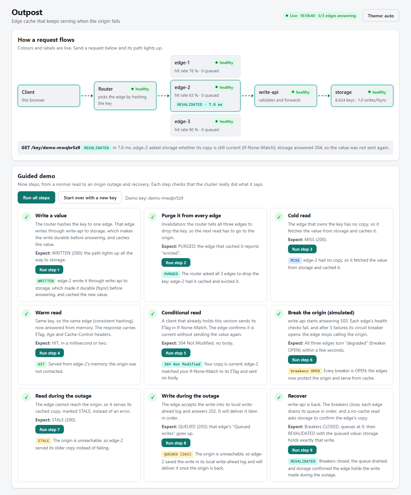
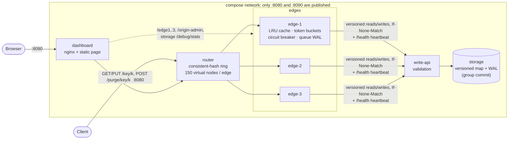
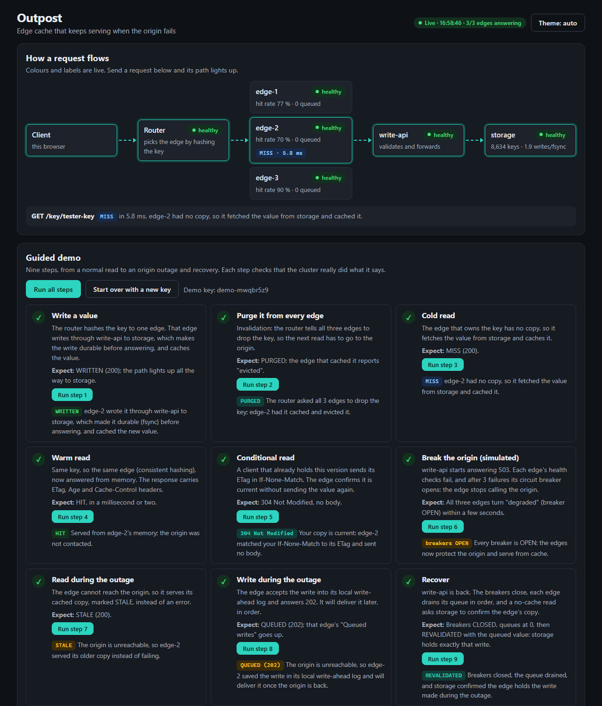

<div align="center">

# Outpost

**A fault-tolerant edge/origin request router in C++17.**<br>
Cached reads keep flowing, and no acknowledged write is lost, even while the origin is down.

[](https://github.com/kush300304/Outpost/actions/workflows/ci.yml)
[](LICENSE)


[Quick start](#quick-start) · [Run it locally](#run-it-locally) · [How it works](#how-it-works) ·
[Design decisions](#design-decisions) · [Results](#results) · [Documentation](#documentation)



</div>

## At a glance

| **0 lost writes** | **113.9 → 7.9 ms** | **≈ 1 ms** | **77 %** | **163 tests** |
|:---:|:---:|:---:|:---:|:---:|
| in chaos tests that kill storage, write-api and an edge under load | PUT p50 with group commit, at the same load, every write still fsync'd | cache-hit p50 through the router | of conditional reads answered `304` with no body (1 % writes) | unit and in-process, clean under ASan, UBSan and TSan |

Every number on this page comes from a real run whose raw output is committed. Nothing is estimated.

## Why Outpost

Many edge servers answer reads close to users, and one origin owns the data. That is how CDNs and large web
services are built. Outpost is a small, complete version of that architecture, built to show how it behaves when
things go wrong.

| The problem | Outpost's answer |
|---|---|
| **The origin fails, and everything fails with it.** Every edge keeps calling it, threads pile up behind timeouts, and the retries flood it as it tries to recover. | A **circuit breaker** per edge fails fast. While the origin is down it serves cached copies (`STALE`), queues writes, and lets exactly **one** probe through to test recovery. |
| **Writes made during an outage are lost.** | Each edge keeps a **durable write queue** (a hand-built write-ahead log) and replays it in order on recovery. Versioned writes make every replay safe: nothing is lost or applied twice. |
| **Scaling reshuffles every key.** With `hash % N`, adding a server remaps almost everything, so every cache goes cold at once. | **Consistent hashing** with 150 virtual nodes per edge: adding or removing an edge moves only its share of keys. |
| **Clients re-download data that hasn't changed.** | **Standard HTTP caching:** `ETag`, `304 Not Modified`, revalidation with the origin, `stale-if-error`, and a purge API. |

**What's inside**
- **Five primitives, written by hand** in `common/` with no third-party code: a consistent hash ring, an LRU
  cache, a token bucket, a circuit breaker and a write-ahead log with group commit.
- **Four services:** a stateless router, three edges, a validating write-api, and a versioned key-value store.
- **A live dashboard** with a self-checking, nine-step demo of the failure story.
- **Evidence:** unit, sanitizer, integration, chaos and browser tests, and k6 benchmarks, all run in CI or
  recorded with the hardware they ran on.

## Quick start

All you need is Docker with Compose v2.

```bash
git clone https://github.com/kush300304/Outpost.git && cd Outpost
docker compose up -d --build --wait     # router, 3 edges, write-api, storage, dashboard
```

Then open **http://localhost:8090** and click **Run all steps**. Or talk to the API directly:

```bash
curl -X PUT localhost:8080/key/hello -d world
curl -i localhost:8080/key/hello                                      # X-Cache: HIT, ETag: "<version>-edge-N"
curl -i -H 'If-None-Match: "<that ETag>"' localhost:8080/key/hello    # 304 Not Modified, no body
curl -i -H 'Cache-Control: no-cache' localhost:8080/key/hello         # X-Cache: REVALIDATED
curl -X POST localhost:8080/purge/key/hello                           # {"complete":true,"edges":[…]}
```

| Port | What |
|---|---|
| 8080 | Router, the API: `GET`/`PUT /key/<key>`, `POST /purge/key/<key>`, `/debug/route/<key>`, `/debug/stats` |
| 8090 | Dashboard |

The edges (8081–8083), write-api (9090) and storage (9091) are reachable only inside the Compose network.

## Run it locally

### Option A: with Docker (recommended, includes the dashboard)

**You need:**
- Git;
- Docker:
  - Windows or macOS: **Docker Desktop**. On Windows, run the commands in a WSL 2 terminal with Docker Desktop's
    WSL integration turned on.
  - Linux: Docker Engine with the Compose v2 plugin.
- Ports 8080 and 8090 free.

1. **Get the code:** `git clone https://github.com/kush300304/Outpost.git && cd Outpost`.
2. **Start everything:** `docker compose up -d --build --wait`.
   - The first build compiles every service in containers and takes a few minutes; later starts take seconds.
   - `--wait` returns once all seven services report healthy. Check with `docker compose ps`.
3. **Explore:** open http://localhost:8090, or use the `curl` commands above.
4. **Watch the logs:** `docker compose logs -f edge-1 edge-2 edge-3`.
   - Services log to standard output, and Docker stores it, so there is no logs folder.
   - Timestamps are UTC.
   - `LOG_LEVEL=debug docker compose up -d storage` makes storage log every write.
5. **Break it on purpose:** `docker compose stop storage`, then read a cached key (`X-Cache: STALE`) and write a
   new one (`202`, queued). Then `docker compose start storage` and watch the queue drain in the logs.
6. **Stop:** `docker compose down` keeps the stored data in Docker volumes; `docker compose down -v` deletes it
   too.

Settings are listed in [`.env.example`](.env.example): cache size, TTL, `stale-if-error`, rate limits, fsync,
the admin endpoint and `LOG_LEVEL`. Copy it to `.env` to change them.

### Option B: without Docker (Linux or WSL)

**You need:** CMake ≥ 3.16, a C++17 compiler (tested with g++ 12, 13 and 15), and curl. The first configure
downloads cpp-httplib, nlohmann/json, spdlog and GoogleTest with CMake's FetchContent.

```bash
cmake -S . -B build && cmake --build build -j     # build every service
ctest --test-dir build                            # 163 tests, under 10 s
scripts/localCluster.sh start                     # storage, write-api, edge-1..3, router on the same ports
scripts/localCluster.sh status
curl -X PUT localhost:8080/key/hello -d world && curl -i localhost:8080/key/hello
scripts/localCluster.sh kill storage              # simulate a crash; start it again with: start storage
scripts/localCluster.sh stop
```

Logs and write-ahead logs go to `build/localCluster/<service>.log` and `.wal`. The dashboard needs the Docker
setup, because nginx serves it.

<details>
<summary><b>Troubleshooting</b></summary>

- **`port is already allocated`:** another program uses 8080 or 8090. Stop it, or change the published ports in
  `docker-compose.yml`.
- **`Cannot connect to the Docker daemon`:** start Docker Desktop. On Windows, enable *Settings → Resources → WSL
  integration* for your distribution.
- **A service shows `unhealthy`:** read its log with `docker compose logs <service>`. `docker compose down -v &&
  docker compose up -d --build --wait` starts from scratch.
- **The dashboard shows an old version after an update:** reload the page with Ctrl + Shift + R.

</details>

For a guided, step-by-step walk through everything (what each piece is for, what to run, what you should see
and what it proves), follow **[docs/handsOnTour.md](docs/handsOnTour.md)**.

## How it works



| Service | Responsibility |
|---|---|
| **router** (8080) | Stateless entry point. Hashes the key onto a ring of healthy edges and forwards the request. Drops an edge after failed health checks and retries once on the new owner. Fans a purge out to every edge. |
| **edge ×3** | Cache-aside reads with a TTL and standard HTTP caching headers, per-client token buckets, a circuit breaker driven by heartbeats, and a durable write queue. |
| **write-api** | Validates requests; the only client of storage. Healthy only when storage answers. |
| **storage** | The source of truth: a versioned key-value map, durable through its write-ahead log, where concurrent writes share fsyncs. |
| **dashboard** (8090) | A live view of the cluster, a guided demo and request tools (plain HTML/CSS/JS behind nginx). |

**In one paragraph:**
- **Normal operation:** a read is answered from the owning edge's cache (`HIT`) or fetched once from the origin
  (`MISS`). A write is stamped with a version at the edge and stored durably before it is acknowledged.
- **When the origin fails,** each edge's breaker opens within seconds. Cached values are then served as `STALE`
  and writes are queued (`202`).
- **When the origin recovers,** one probe closes the breaker, and each edge replays its queue in order with the
  original versions. Storage keeps the newest version of every key, so replays are harmless.

<details>
<summary><b>The request flows in detail</b></summary>

**Read path.**
1. The router picks the owning edge for the key and forwards the request: the key percent-encoded, the client
   address in `X-Forwarded-For`, and the client's `If-None-Match` and `Cache-Control`.
2. The edge takes a token from that client's bucket (`429` + `Retry-After` when it is empty).
3. A fresh cached value is a `HIT`.
4. If the client's `If-None-Match` matches the value's ETag, the answer is `304 Not Modified` with no body.
5. A missing value is fetched from write-api while the breaker is CLOSED, cached with its version, and answered
   as `MISS`.
6. An expired value, or any value the client requests with `Cache-Control: no-cache`, is **revalidated**: the
   edge sends the origin its ETag. If the value is unchanged, the origin answers `304`, the edge keeps its copy,
   and the answer is `REVALIDATED`; the value is not sent again.

Every answer that carries a value has these headers:
- `ETag: "<version>-<writerId>"`, the identity of the write that produced the value;
- `Last-Modified`;
- `Age`;
- `Cache-Control: max-age=<remaining ttl>, stale-if-error=3600`.

**Write path.**
1. The edge validates the size and stamps the write with a `(version, writerId)`: microseconds, strictly
   increasing per edge, and the edge's id.
2. While the breaker is CLOSED, it forwards the write (`200`, `X-Write-Mode: DIRECT`, and the write's `ETag`).
3. Storage applies the write only if its version is newer than what it holds.
4. Storage acknowledges the write only once it is in the write-ahead log on disk. Writes that arrive together
   share one fsync (group commit).

**Degraded mode.**
- Every edge heartbeats write-api once a second. Three consecutive failures open the breaker; failed requests
  count too.
- While the breaker is OPEN:
  - the edge sends the origin **no traffic at all**;
  - cached values are served as `X-Cache: STALE` for up to ttl + `stale-if-error` (1 h by default);
  - writes are appended to the edge's write-ahead log and answered `202 QUEUED`;
  - reads with no usable cached copy answer `503`.

**Recovery.**
1. After 5 s the breaker admits exactly **one** half-open probe. Success closes it.
2. The edge then drains its queue: every write is replayed in order with its **original** version, and only the
   prefix the origin acknowledged is removed from the log.
3. Writes queued during the drain are never lost. A replay of a write that already landed is a `duplicate`, and
   a replay that lost to a newer write is `superseded`. Either way it is applied at most once and never
   overwrites newer data.

**Purge.** `POST /purge/key/<k>` on the router asks **every configured edge** to drop the key, including an
edge that is currently off the ring. The answer is `200` when every edge confirmed. When an edge could not be
reached, the answer is `502` with `complete: false`, and the response lists every edge's answer.

</details>

More detail: [docs/architecture.md](docs/architecture.md), the edge stats contract in
[docs/statsApi.md](docs/statsApi.md), and the long-form explanation of every module, decision and bug in
[docs/designWalkthrough.md](docs/designWalkthrough.md).

## Design decisions

Each decision has a short record in [`docs/adr/`](docs/adr/README.md).

| Decision | Why | Trade-off |
|---|---|---|
| **Availability over consistency** during an outage ([ADR 1](docs/adr/0001-availability-over-consistency.md)) | Users keep getting answers. Data converges through versioned last-writer-wins. | A client can read a value that has since changed elsewhere. Staleness is bounded by the 60 s TTL, and by 1 h during an outage. |
| **Versioned writes** `(version, writerId)` ([ADR 2](docs/adr/0002-versioned-last-writer-wins.md)) | One durable comparison gives idempotent replay (`duplicate`) and no stale overwrites (`superseded`). | Ordering uses edge clocks (one host here; NTP across hosts). No deletes, because they need tombstones. |
| **A hand-built write-ahead log** ([ADR 3](docs/adr/0003-hand-built-write-ahead-log.md)) | CRC-checked records; recovery keeps valid records, skips a damaged one and cuts a torn tail. | The project owns crash-safety code, and the storage log is never compacted. |
| **A separate, stateless router** ([ADR 4](docs/adr/0004-stateless-router-service.md)) | Clients don't need the ring. A restart rebuilds the same ring, and a dead edge's keys move alone. | One extra hop, and the edge list is static configuration. |
| **Consistent hashing, 150 virtual nodes** ([ADR 5](docs/adr/0005-consistent-hashing-virtual-nodes.md)) | The `fmix64` finalizer turned a 10 / 56 / 34 % split into 32.0 / 36.2 / 31.9 %. A fourth edge moves 29.3 % of keys (ideal 25 %). | O(log n) lookups over 450 points. |
| **Breaker: 3 failures, 1 s heartbeat, 5 s reset, one probe** ([ADR 6](docs/adr/0006-circuit-breaker-thresholds.md)) | Outages are detected in 0.7–5.3 s (measured), and a recovering origin sees one probe, not a stampede. | Lower thresholds flap on blips; higher ones serve errors longer. |
| **Group commit, no batching window** ([ADR 7](docs/adr/0007-group-commit-without-window.md)) | PUT p50 113.90 → 7.90 ms at the same load, still durable. A failed fsync stops the log. | Writes share an fsync only when they overlap: 2.99 per fsync under heavy load, about 1 under light load. |
| **Standard HTTP caching; the write identity is the ETag** ([ADR 8](docs/adr/0008-standard-http-caching-and-purge.md)) | Any HTTP client or cache can revalidate. Purge reaches every edge, even one off the ring. | Writer ids are limited to `[A-Za-z0-9._-]`. Purge is one key at a time and best-effort for an unreachable edge. |

Logs go to standard output, not files. Only state changes and errors are logged, never each request.
**Out of scope:** authentication (trusted network, see [SECURITY.md](SECURITY.md)), multi-region routing,
deletes, strong consistency and log compaction.

## The dashboard

Open **http://localhost:8090**. Everything on it is live: the page polls every service once a second.

- **How a request flows:** Client → Router → edge-1..3 → write-api → storage, each labelled healthy, degraded or
  down. Send a request and its path lights up, with the result on the edge that served it and a sentence
  explaining what happened.
- **Guided demo:** *Run all steps* plays the whole story in about 10 seconds:
  1. write;
  2. purge;
  3. cold `MISS`;
  4. warm `HIT`;
  5. `304`;
  6. simulated outage, with every breaker OPEN;
  7. `STALE` read;
  8. `QUEUED` write;
  9. recovery, where a `REVALIDATED` read proves storage holds the queued write.

  Each step checks the real response or the live state, and turns green only if the cluster really did it.
- **Panels and tools:**
  - per-edge cards (hit rate, breaker, queue, revalidations, rate limiting), with every label explained;
  - router and origin cards (how requests spread; writes per fsync);
  - a request tester with `If-None-Match`, `no-cache` and purge;
  - a simulated-outage switch;
  - a small load generator;
  - a filterable event log, and a glossary.

<p>


</p>

## Results

Measured on one machine: AMD Ryzen 5 5600H (12 threads), 7.4 GiB RAM, Windows WSL2 with Docker Desktop 29.9.3.
Raw output is in [`benchmarks/results/`](benchmarks/results/README.md) and [`docs/gates/`](docs/gates/README.md),
and the commit hashes quoted there are commits in this repository. A
[final check from a fresh clone](docs/finalCheck.md) reran everything after the last code change.

**Chaos test**: continuous reads and writes through the router while storage, then write-api, are killed and
restarted, and then an edge is killed 200 ms into replaying its queue.

| Measure | Gate run (`2026-11-21T105727Z`) | Final check (`2026-11-21T123241Z`) |
|---|---|---|
| Acknowledged writes (200/202) persisted with the exact value | **3448 / 3448** | **2834 / 2834** |
| Warm reads during the storage and write-api outages | 1689, **0 failed** (1352 `STALE`) | 1569, **0 failed** (1173 `STALE`) |
| Replayed writes recognised as duplicates after the mid-drain edge kill | 50, none applied twice | 59, none applied twice |

**Group commit, at the same load**: 2587 requests/s, 90 % GET / 10 % PUT over 1000 keys, every write fsync'd:

| Request | Before: one fsync per write | After: group commit |
|---|---|---|
| GET, cache hit, p50 / p95 / p99 | 0.96 / 1.24 / 1.64 ms | 0.98 / 1.36 / 2.45 ms |
| PUT, p50 / p95 / p99 | 113.90 / 123.73 / 214.76 ms | **7.90 / 10.82 / 13.92 ms** |

**HTTP caching**: 4 KiB values; each client sends the ETag it last saw:

| PUT share | Conditional reads answered `304` | `304` p50 | `REVALIDATED` p50 | Body bytes `304` / `200` |
|---|---|---|---|---|
| 1 % | **77.4 %** | 2.94 ms | 5.01 ms | **0 / 4126** |
| 10 % | 26.2 % | 3.26 ms | 5.79 ms | 0 / 4126 |

<details>
<summary><b>More results and how to read them</b></summary>

**At full speed** (32 clients, each sending its next request as soon as the last one returns):

| | Before | After (3 runs) |
|---|---|---|
| Throughput | 2587 requests/s | **6550–7138 requests/s** (2.6×) |
| PUT p50 | 113.90 ms | 12.33–13.04 ms |
| GET cache hit, p50 / p95 / p99 | 0.96 / 1.24 / 1.64 ms | 2.95 / 8.03 / **11.29** ms |
| Writes per fsync | 1 | 2.99 |

- **Writes:** before, each write waited for its own fsync behind a lock, so writers queued. Now writes that
  arrive together share one.
- **Reads at the same load** are unchanged at the median.
- **Reads at full speed got slower** because the machine serves 2.6× more requests. A run with fsync off showed a
  similar p50 (3.33 ms at 7655 requests/s). At this load the cache-hit **p99 (11.29 ms) is above the 10 ms
  target**; p50 and p95 are below it.
- **The 304 share depends on churn:** how often a key changes between two visits by the same client. Both runs
  match a simple model within a few points.
- **The saving is bandwidth, not latency:** on one machine a 304 is only 0.2 ms faster, but in the 1 % run 304s
  avoided sending about 1.39 GB of bodies in 60 s.
- **What the benchmarks found:** two real defects, both fixed with regression tests. Nagle's algorithm added
  ~40 ms to every keep-alive request, and idle keep-alive connections could starve the HTTP worker pool.
- **Units:** *requests/s* is the count during the 60 s measured phase. Older gate files quote k6's whole-run
  average, which includes a ~6 s setup phase and is about 10 % lower.
- **Variance:** the final check's benchmarks came out 10–20 % slower than the gate runs, on the same laptop with
  the same code (for example PUT p50 8.76 ms instead of 7.90 ms at 2587 requests/s). Treat single laptop
  numbers as ±20 %; every comparison held in every run.

Details: [docs/benchmarks.md](docs/benchmarks.md).

</details>

## Testing

| What | Command | A pass looks like |
|---|---|---|
| Unit and in-process tests (163) | `cmake -S . -B build && cmake --build build -j && ctest --test-dir build` | `100% tests passed, 0 tests failed out of 5` |
| ASan + UBSan | `cmake -S . -B build-asan -DOUTPOST_SANITIZE=address,undefined && cmake --build build-asan -j && ctest --test-dir build-asan` | 100 % passed, no sanitizer reports |
| ThreadSanitizer | same, with `-B build-tsan -DOUTPOST_SANITIZE=thread` | 100 % passed, no `ThreadSanitizer` warnings |
| Style | `python3 scripts/checkStyle.py && scripts/format.sh --check` | `0 violations` and `all formatted` |
| Integration (Compose) | `scripts/integrationTest.sh` | `integrationTest: 0 failed check(s)` (21 checks) |
| Chaos (Compose) | `scripts/chaosTest.sh` | `RESULT: PASS`: acknowledged writes persisted = sent |
| Benchmark (Compose) | `scripts/runBenchmark.sh 60s 32`; `RATE=2587 …` for a fixed load; `WORKLOAD=conditional …` for 304s | a new `benchmarks/results/<date>-…/summary.md` |
| Dashboard acceptance | `scripts/dashboardAcceptance.sh` | `dashboardAcceptance: 0 failed check(s)` (18 checks) |
| Dashboard in a real browser (Windows + Chrome) | `dashboard/tests/browserClickTest.ps1` | every guided-demo step `passed`, 0 console errors |
| Graceful shutdown | `scripts/shutdownTest.sh` | `PASS` for all four services |

CI runs the unit tests, both sanitizer builds, the style checks and the Compose integration test on every push.
The manual checklist is in [docs/testing.md](docs/testing.md).

## Documentation

| Read this | When you want |
|---|---|
| [docs/handsOnTour.md](docs/handsOnTour.md) | A guided, step-by-step tour: run each piece and see what it proves |
| [docs/designWalkthrough.md](docs/designWalkthrough.md) | The long-form explanation of every module, decision and bug |
| [docs/architecture.md](docs/architecture.md) | The components, request paths, durability and consistency model |
| [docs/adr/](docs/adr/README.md) | One short record per major design decision |
| [docs/benchmarks.md](docs/benchmarks.md) | How the benchmarks were run, and every result |
| [docs/statsApi.md](docs/statsApi.md) | The edges' `/debug/stats` contract (a test enforces it) |
| [docs/testing.md](docs/testing.md) | The manual test checklist, including the dashboard |
| [docs/gates/](docs/gates/README.md), [docs/finalCheck.md](docs/finalCheck.md) | The raw output behind every number |
| [CHANGELOG.md](CHANGELOG.md) | What is in each release |

## Known limitations and roadmap

<details>
<summary><b>Limitations</b></summary>

- **Write ordering:** depends on wall clocks (fine on one host, needs NTP across hosts). A hybrid logical
  clock would remove that.
- **Group commit:** only helps when writes overlap (1.05 writes per fsync under light load). A short batching
  window would batch more, but would add latency to every write.
- **Storage log growth:** the storage write-ahead log grows without compaction, and start-up replays it (about
  3.7 s for 300,000 records in a Debug build).
- **HTTP caching scope:** conditional requests use ETags only, not `If-Modified-Since`; `Age` is per edge; purge
  removes one key at a time and is best-effort for an unreachable edge.
- **No deletes:** they need versioned tombstones.
- **Breaker trigger:** consecutive failures only, no error-rate window.
- **Membership:** the router's edge list is static configuration. Adding an edge means a config change and a
  router restart (about 1/(N+1) of keys move).
- **Edge failover:** when an edge dies, the first request for one of its keys waits about 1 s (one bounded DNS
  attempt) before the router fails over, and health checks drop the edge after 1.8 s. A request already in
  flight to the dying edge fails (11 of 267 reads in the final chaos run's edge-kill window).
- **Logs:** plain text, without a request id that follows one request across services.

</details>

**Ideas for v2:**
- structured JSON logs with a request id across hops;
- purge by tag or prefix;
- Kafka cache invalidation between edges;
- gRPC;
- Prometheus and Grafana;
- gossip-based membership;
- Kubernetes;
- a Terraform cloud deployment.

## Repository layout

```
common/      hand-built primitives: consistentHash, lruCache, tokenBucket, circuitBreaker, wal (+ httpCache,
             urlEncode, requestLimits, shutdownSignal), with their tests in common/tests
router/      consistent-hash router service
edge/        edge service
write-api/   validation service in front of storage
storage/     versioned key-value store with write-ahead-log durability
dashboard/   static dashboard (ES modules in src/), nginx config, browser click test in tests/
scripts/     localCluster, integrationTest, chaosTest, runBenchmark, dashboardAcceptance, seedData,
             shutdownTest, checkStyle, format
benchmarks/  k6 workloads (readHeavy, conditional) and dated results
docs/        architecture, design walkthrough, hands-on tour, stats API, benchmarks, testing checklist,
             decision records (adr/), gate records, final checks, images
```

**Contributing:** see [CONTRIBUTING.md](CONTRIBUTING.md). **Security model and reporting:**
[SECURITY.md](SECURITY.md). **Licence:** [MIT](LICENSE).
