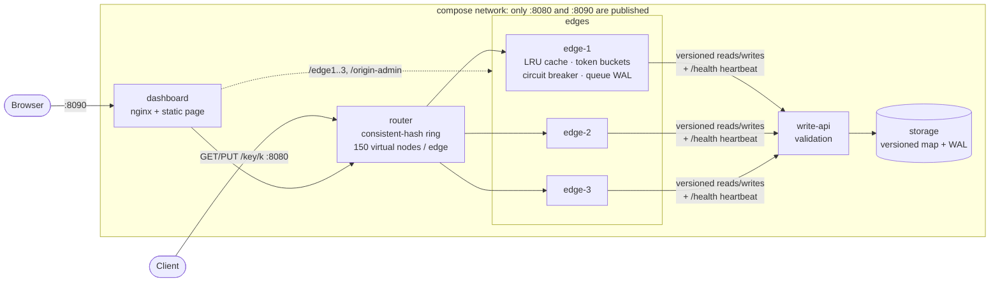

# Outpost

**A fault-tolerant edge/origin request router in C++17.** Outpost puts consistent-hash routing, per-edge
caching, rate limiting and a circuit breaker in front of a small authoritative origin. When the origin fails,
the system degrades instead of falling over: cached reads keep being served, writes are queued durably at the
edge, and everything reconciles, without loss or double-apply, when the origin comes back.

The five core primitives (consistent hash ring, LRU cache, token bucket, circuit breaker, write-ahead log) are
hand-built in `common/` with no third-party code. The services use cpp-httplib, nlohmann/json and spdlog.

## The problem

Systems that serve reads from many edge nodes and send writes to one source of truth usually fail in two ways:

1. **Retry storms turn "slow" into "dead".** When the origin slows down, every edge retries at once, the
   origin gets more load exactly when it can least take it, and the failure cascades.
2. **Naive routing reshuffles everything on scale events.** With `hash(key) % N`, adding or removing one node
   remaps almost every key, so every cache goes cold at the moment you are scaling.

Outpost addresses both:
- A **circuit breaker** per edge stops calling a failing origin and serves cached data instead.
- **Consistent hashing with virtual nodes** moves only about 1/N of the keys when the edge fleet changes.

## Architecture



| Service | Responsibility |
|---|---|
| **router** (8080) | Stateless. Hashes the key onto a ring of healthy edges and forwards the request; removes an edge after failed health checks and retries once on the new owner. |
| **edge ×3** | Cache-aside reads with a TTL, per-client token buckets, a circuit breaker driven by heartbeats, and a write queue in a local WAL. |
| **write-api** | Validates requests; the only client of storage. Healthy only when storage answers. |
| **storage** | The source of truth: a versioned key-value map, durable through its WAL. |
| **dashboard** (8090) | Live view of the cluster plus demo controls (plain HTML/CSS/JS behind nginx). |

### Request flows

**Read path.**
1. The router picks the owning edge for the key and forwards the request (key percent-encoded, client address
   in `X-Forwarded-For`).
2. The edge takes a token from that client's bucket (`429` + `Retry-After` when it is empty).
3. A fresh cached value is a `HIT`.
4. Otherwise, while the breaker is CLOSED, the edge fetches from write-api, caches the value with its version,
   and answers `MISS`.

**Write path.**
1. The edge validates the size and stamps the write with a `(version, writerId)`: microseconds, strictly
   increasing per edge, and the edge's id.
2. While the breaker is CLOSED, it forwards the write (`200`, `X-Write-Mode: DIRECT`).
3. Storage applies the write only if its version is newer than what it holds.

**Degraded mode.**
- Every edge heartbeats write-api once a second. Three consecutive failures open the breaker; failed requests
  count too.
- While the breaker is OPEN:
  - the edge sends the origin **no traffic at all**;
  - cached values, even expired ones, are served as `X-Cache: STALE`;
  - writes are appended to the edge's WAL and answered `202 QUEUED`;
  - uncached keys answer `503`.

**Recovery.**
1. After 5 s the breaker admits exactly **one** half-open probe. Success closes it.
2. The edge then drains its queue: every write is replayed in order with its **original** version, and only the
   prefix the origin acknowledged is removed from the WAL.
3. Writes queued during the drain are never lost. A replay of a write that already landed is a `duplicate`, and
   a replay that lost to a newer write is `superseded`. Either way it is applied at most once and never
   overwrites newer data.

More detail: [docs/architecture.md](docs/architecture.md); edge stats contract:
[docs/statsApi.md](docs/statsApi.md).

## Design decisions and trade-offs

- **AP/BASE, not ACID.**
  - **Choice:** during an origin outage Outpost chooses availability. Edges serve stale data and accept writes
    they cannot commit yet.
  - **Convergence:** values converge once the origin returns, through versioned last-writer-wins. Caches are
    refreshed within `CACHE_TTL_MS` (60 s).
  - **Cost:** a client can read a value that has since been overwritten elsewhere, and two concurrent writers
    are ordered by edge clocks (same host here; NTP across hosts).
- **A write-ahead log, hand-built.**
  - **Use:** both the storage service and every edge queue use `common/wal`. Each record carries a magic
    number, a CRC over its length and payload, a sequence number, the write's version and writer.
  - **Recovery:** on open it keeps every valid record, skips a damaged middle record, and truncates only a torn
    tail.
  - **Durability:** each append is fsync'd. The benchmark measures what that costs (see Results), and group
    commit is a v2 item.
- **Versioned writes: idempotency and ordering in one place.** Instead of a separate idempotency-key store,
  storage keeps the `(version, writerId)` of every value. One comparison makes replays idempotent (`duplicate`)
  and prevents stale overwrites (`superseded`), and it is durable because it lives in storage's WAL.
- **A separate, stateless router.** Clients shouldn't need to know the ring.
  - The router derives the ring from configuration plus health checks and persists nothing.
  - Ownership doesn't depend on insertion order, so a restarted router routes exactly like before.
  - A dead edge leaves the ring, and only its keys move.
- **Consistent hashing with 150 virtual nodes per edge.**
  - Virtual nodes smooth out ownership, but only if the hash spreads similar strings well.
  - Plain FNV-1a gave a 10 / 56 / 34 % split. Adding the MurmurHash3 `fmix64` finalizer gives 32.0 / 36.2 /
    31.9 %.
  - Adding a node now moves 29.3 / 23.0 / 16.4 % of keys (ideal 25 / 20 / 16.7 %).
- **Breaker thresholds: 3 failures, 1 s heartbeat, 5 s reset.**
  - An outage is detected in about 3 s (measured 2.5–3.1 s with storage killed or the outage simulated).
  - During recovery the origin sees a single probe, not a thundering herd.
  - A probe whose result is lost is replaced after the same timeout, so the breaker can't wedge in HALF_OPEN.
  - Lower thresholds react faster but flap on transient errors; higher ones serve errors for longer.
- **Out of scope for v1:** authentication (trusted network), multi-region routing, deletes (they would need
  versioned tombstones), strong consistency, WAL compaction and group commit.

## Quick start

Prerequisites: Docker with Compose v2. For building and testing outside Docker you also need CMake ≥ 3.16 and
a C++17 compiler (tested with g++ 15 locally and 12/13 in containers and CI). The first build downloads the
dependencies with CMake's FetchContent.

```bash
docker compose up -d --build --wait     # router, 3 edges, write-api, storage, dashboard
curl -X PUT localhost:8080/key/hello -d world
curl -i localhost:8080/key/hello        # X-Cache: HIT, X-Node: edge-N
```

| Port | What |
|---|---|
| 8080 | Router: the API (`GET`/`PUT /key/<key>`, `/debug/route/<key>`, `/debug/stats`) |
| 8090 | Dashboard |

Edges (8081–8083), write-api (9090) and storage (9091) are reachable only inside the compose network.
`scripts/localCluster.sh start` runs the same services on the same ports without Docker (no dashboard).

## How to test it yourself

| What | Command | A pass looks like |
|---|---|---|
| Unit and in-process tests (140) | `cmake -S . -B build && cmake --build build -j && ctest --test-dir build` | `100% tests passed, 0 tests failed out of 5` |
| ASan + UBSan | `cmake -S . -B build-asan -DOUTPOST_SANITIZE=address,undefined && cmake --build build-asan -j && ctest --test-dir build-asan` | 100 % passed, no `AddressSanitizer`/`runtime error`/`LeakSanitizer` output |
| ThreadSanitizer | same with `-B build-tsan -DOUTPOST_SANITIZE=thread` | 100 % passed, no `ThreadSanitizer` warnings |
| Style rules | `python3 scripts/checkStyle.py && scripts/format.sh --check` | `0 violations` and `all formatted` |
| Integration (compose) | `scripts/integrationTest.sh` | `integrationTest: 0 failed check(s)` |
| Chaos (compose) | `scripts/chaosTest.sh` | `RESULT: PASS`, acknowledged writes persisted = acknowledged writes sent |
| Benchmark (compose) | `scripts/runBenchmark.sh 60s 32` | a new `benchmarks/results/<date>-benchmark/summary.md` |
| Dashboard acceptance | `scripts/dashboardAcceptance.sh` | `dashboardAcceptance: 0 failed check(s)` |
| Graceful shutdown | `scripts/shutdownTest.sh` | `PASS` for all four services (exit 0 within 2 s of SIGTERM) |

**The chaos test**:
- **Load:** runs continuous reads of 200 warm keys and a stream of unique writes through the router.
- **Kills and restarts:** first storage, then write-api, then an edge, killed 200 ms into replaying its queue.
- **Pass criteria:**
  - every write that got `200` or `202` must be in storage with its exact value;
  - no warm read may fail during the outages.

CI runs the unit tests, both sanitizer builds, the style checks and the compose integration test on every push
(`.github/workflows/ci.yml`). The full manual checklist is in [docs/testing.md](docs/testing.md).

## Using the dashboard

Open **http://localhost:8090**. Each panel updates every second.

1. **Cold miss:** in *Request tester*, `GET` key `demo`. You get `404` with `X-Cache: MISS`: the edge asked the
   origin and the key does not exist.
2. **Write:** switch to `PUT` with a value and send. You get `200`, `X-Write-Mode: DIRECT`, and the edge that
   owns the key.
3. **Hit:** `GET demo` again. You get `X-Cache: HIT` from the same edge.
4. **Simulated outage:** press *Start simulated outage*. write-api now answers 503 (no container is stopped).
   Within about 3 s every edge turns **degraded (OPEN)**, and the event log shows `CLOSED -> OPEN`.
5. **Stale reads:** `GET demo`. You get `200` with `X-Cache: STALE`: still served, from the cache.
6. **Queued write:** `PUT` another key. You get `202`, `X-Write-Mode: QUEUED`, and that edge's *Queued writes*
   goes up.
7. **Recovery:** press *Stop simulated outage*. After the 5 s reset timeout the breakers go `HALF_OPEN ->
   CLOSED`, the queue drains to 0, and the event log shows `reconcile: started` / `finished`.
8. **Load:** *Mini load generator* runs N GETs at concurrency C and shows HIT/MISS/STALE/429 counts. Its
   latencies are browser-measured, not a benchmark.

## Results

All numbers come from real runs on one machine: AMD Ryzen 5 5600H (12 threads), 7.4 GiB RAM, Windows WSL2
with Docker Desktop 29.9.3. Raw output is in `docs/gates/` and `benchmarks/results/`.

**Tests**
- **Unit and in-process:** 140 tests in 5 suites, all passing (`docs/gates/phaseG.md`).
- **Sanitizers:** ASan + UBSan and TSan runs pass every suite with 0 sanitizer reports
  (`docs/gates/phaseE.md`). They found a null-pointer `fwrite`, a data race on request counters, a test
  `shared_ptr` cycle, and a temp-file reuse bug, all fixed.

**Chaos test** (`benchmarks/results/2026-11-20T205708Z-chaos/`)

| Measure | Result |
|---|---|
| Writes acknowledged (200/202) / persisted with exact value | **3388 / 3388** |
| Warm reads during the storage and write-api outages | 2112, **0 failed**, 1626 served `STALE` |
| Time for all breakers to open | 2.45 s (storage killed), 0.70 s (write-api killed) |
| Edge killed 200 ms into draining 282 queued writes | storage recognised **41 replayed duplicates**; none applied twice |

**Benchmark** (`benchmarks/results/2026-11-20T205135Z-benchmark/`, details in [docs/benchmarks.md](docs/benchmarks.md))

The run used k6 with 32 clients for 60 s, 90 % GET / 10 % PUT over 1000 keys, through the router, with
per-write fsync on. It sustained **2286 requests/s** with 0 failed requests.

| Request | p50 | p95 | p99 |
|---|---|---|---|
| GET, cache hit | **1.07 ms** | 1.44 ms | 1.97 ms |
| PUT (fsync on) | 115.58 ms | 126.30 ms | 220.44 ms |
| PUT (fsync off, comparison run) | 6.04 ms | 10.40 ms | 13.08 ms |

- **Cache hits:** well under the 10 ms target.
- **Writes:** the fsync column is the measured price of durability. Storage applies writes one at a time and
  fsyncs each, so 32 concurrent writers queue. With fsync off the same run reached 7360 requests/s.
- **What the benchmark found:** two real defects, both fixed with regression tests:
  - Nagle's algorithm added ~40 ms to every keep-alive request;
  - idle keep-alive connections could starve the HTTP worker pool.

## Known limitations and roadmap

- **Write ordering:** depends on wall clocks (fine on one host, needs NTP across hosts). A hybrid logical
  clock would remove that.
- **Write latency:** writes are serialized behind one fsync each. Group commit would batch them.
- **Storage WAL growth:** the storage WAL grows without compaction, and start-up replays it (about 3.7 s for
  300,000 records in a Debug build).
- **No deletes:** v1 has no deletes, because they need versioned tombstones.
- **Breaker trigger:** consecutive failures only, no error-rate window.
- **Membership changes:** the router's edge list is static configuration. Adding an edge means a config change
  and a router restart (about 1/(N+1) of keys move).
- **Edge failover cost:** when an edge dies, the first request for one of its keys waits about 1 s (one bounded
  DNS attempt) before the router fails over (measured 1017 ms), and health checks drop the edge after
  1.8 s.

v2 ideas are listed in [docs/roadmap.md](docs/roadmap.md#v2-ideas-not-built):
- Kafka cache invalidation between edges;
- gRPC;
- Prometheus/Grafana;
- gossip-based membership;
- Kubernetes;
- a Terraform cloud deployment.

## Repository layout

```
common/      hand-built primitives: consistentHash, lruCache, tokenBucket, circuitBreaker, wal (+ urlEncode,
             requestLimits, shutdownSignal), with their tests in common/tests
router/      consistent-hash router service
edge/        edge service
write-api/   validation service in front of storage
storage/     versioned key-value store with WAL durability
dashboard/   static dashboard + nginx config
scripts/     localCluster, integrationTest, chaosTest, runBenchmark, dashboardAcceptance, seedData,
             shutdownTest, checkStyle, format
benchmarks/  k6 workload and dated results
docs/        architecture, stats API, benchmarks, testing checklist, roadmap, gate records
```
