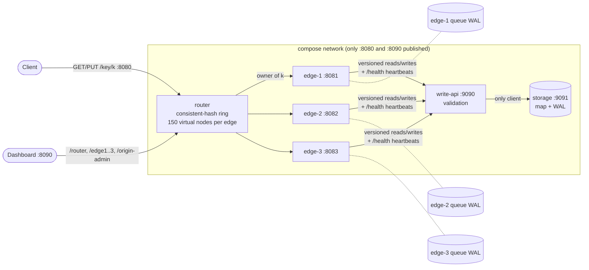

# Outpost architecture

Outpost is a read-heavy key-value request path with one authoritative write path. Clients talk to a stateless
**router**. The router sends each key to one of three **edge** nodes using consistent hashing. Each edge caches
values and protects the origin: **write-api** in front of **storage**, the only service that owns data.

`docker compose up -d --build` runs exactly this layout; `scripts/localCluster.sh` runs the same services
without Docker (no dashboard).

## Components

| Service | Owns | Key code |
|---|---|---|
| router | The hash ring of reachable edges, membership health checks | `router/src/routerServer.cpp`, `common/consistentHash.*` |
| edge (×3) | LRU cache, per-client token buckets, circuit breaker, write queue (WAL) | `edge/src/edgeServer.cpp`, `common/{lruCache,tokenBucket,circuitBreaker,wal}.*` |
| write-api | Request validation, the only client of storage | `write-api/src/apiHandlers.cpp` |
| storage | Authoritative versioned key-value map, durable through its WAL | `storage/src/kvStore.cpp`, `storage/src/storageHandlers.cpp` |

The five primitives in `common/` are hand-built and use no third-party libraries. Services use cpp-httplib,
nlohmann/json and spdlog.

## Write identity: versions

Every write accepted by an edge is stamped with:
- `version`: microseconds since the epoch, strictly increasing per edge;
- `writerId`: the edge's node id.

Storage keeps, for every key, the `(version, writerId)` of the value it holds. It applies a write only when the
incoming pair is newer, and answers `applied`, `duplicate` (same pair, already stored) or `superseded` (an older
write). Only applied writes reach the storage WAL. This one rule makes replay idempotent, and makes it impossible
for an old queued write to overwrite newer data.

## Read path

1. The router hashes the key, picks the owning edge, and forwards the request. The key is percent-encoded and
   the client address is appended to `X-Forwarded-For`.
2. The edge takes a token from that client's bucket (first `X-Forwarded-For` hop). An empty bucket answers
   `429` with `Retry-After: 1`.
3. A fresh cached entry (younger than `CACHE_TTL_MS`, 60 s by default) is answered `X-Cache: HIT` without
   touching the origin.
4. A missing or expired entry is fetched from write-api while the breaker is CLOSED. The result is cached with
   its version and answered `X-Cache: MISS`; an absent key is `404`.

## Write path

1. The edge validates the size (key ≤ 256 B, value ≤ 1 MiB; otherwise `400`) and stamps the version.
2. While the breaker is CLOSED the write goes to write-api, which validates it again and forwards it to
   storage. The answer is `200` with `X-Write-Mode: DIRECT` and the storage outcome.
3. If write-api fails, or the breaker is not CLOSED, the write is appended to the edge's WAL with its version.
   The answer is `202` with `X-Write-Mode: QUEUED`. The cache is updated in both cases, with the write's
   version.

## Degraded mode

Every edge runs a maintenance thread with this cycle:
- **Heartbeat:** when `CircuitBreaker::isAllowed()` says so, it probes write-api `/health`, which is healthy
  only when storage answers.
- **Opening:** `BREAKER_FAILURE_THRESHOLD` consecutive failures (3 by default), counting heartbeats and failed
  requests, open the breaker.
- **While OPEN:**
  - no traffic reaches the origin;
  - cached values, fresh or expired, are served as `X-Cache: STALE`;
  - uncached keys answer `503`;
  - writes are queued.
- **Probe:** after `BREAKER_RESET_TIMEOUT_MS` (5 s by default) the breaker goes HALF_OPEN and admits exactly
  one probe, the next heartbeat. Success closes it; failure reopens it with a fresh timeout. A probe whose
  result is never recorded is replaced after the same timeout.

## Recovery and reconciliation

Whenever the breaker is CLOSED and the queue is not empty, including right after an edge starts, the
maintenance thread drains it:
1. Take a snapshot of the queue.
2. Send each write in order with its **original** version.
3. Stop at the first origin failure, preserving order.
4. Remove exactly the resolved prefix with `WriteAheadLog::discardThrough`.

Writes queued while a drain runs are never lost. A replay of a write that already landed is a `duplicate`. A
replay that lost to a newer write is `superseded`. A write the origin refuses with `4xx` is dropped and counted,
but that can't happen for writes the edge accepted, because it applies the same size limits.

## Router membership

Every configured edge (`EDGE_NODES`) starts on the ring. The router health-checks each edge every
`HEALTH_CHECK_INTERVAL_MS`:
- After `UNHEALTHY_THRESHOLD` consecutive failures the edge leaves the ring, and only its keys move to their
  next owner.
- One success brings it back.
- A refused connection removes the owner immediately, and the request is retried once on the new owner.

The router keeps no state. A restart rebuilds the same ring, because ring ownership doesn't depend on the order
in which nodes were added. Adding a fourth edge means a new `EDGE_NODES` entry and a router restart, and moves
about a quarter of the keys.

## Durability

Both the storage WAL and the edge queues use `common/wal`. Each record is:
- a magic number;
- a CRC-32 over the payload length and payload;
- a sequence number, operation, version, writer id, key and value.

On open:
- every valid record is kept;
- a damaged record in the middle is skipped by resynchronising on the next valid record;
- an invalid tail (a torn final write) is truncated.

Appends are one unbuffered write followed by `fsync` (configurable with `WAL_FSYNC`). A failed append rolls the
file back to its previous size.

## Consistency model

Outpost is AP and BASE, by design:
- During a partition, edges stay available (stale reads, queued writes) instead of failing.
- Values converge through versioned last-writer-wins once the origin is back.
- Cached values are refreshed at most `CACHE_TTL_MS` after they change.

Ordering depends on wall-clock versions: edges on one host share a clock, and a multi-host deployment relies on
NTP. Deletes are not part of v1, because they would need versioned tombstones.

## Ports

| Port | Service | Published by compose |
|---|---|---|
| 8080 | router | yes (client entry point) |
| 8090 | dashboard (nginx: page + proxy to `/router`, `/edge1..3`, `/origin-admin`) | yes |
| 8081–8083 | edge-1..3 | no |
| 9090 | write-api | no |
| 9091 | storage | no |

See `docs/statsApi.md` for the edge `/debug/stats` contract.
