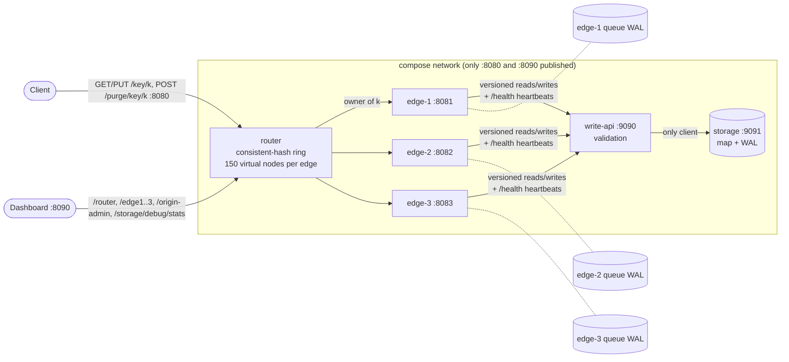

# Outpost architecture

Outpost is a read-heavy key-value request path with one authoritative write path. Clients talk to a stateless
**router**. The router sends each key to one of three **edge** nodes using consistent hashing. Each edge caches
values and protects the origin: **write-api** in front of **storage**, the only service that owns data.

`docker compose up -d --build` runs exactly this layout; `scripts/localCluster.sh` runs the same services
without Docker (no dashboard).

## Components

| Service | Owns | Key code |
|---|---|---|
| router | The hash ring of reachable edges, membership health checks, purge fan-out | `router/src/routerServer.cpp`, `common/consistentHash.*` |
| edge (×3) | LRU cache with HTTP caching headers, per-client token buckets, circuit breaker, write queue (WAL) | `edge/src/edgeServer.cpp`, `common/{lruCache,tokenBucket,circuitBreaker,wal,httpCache}.*` |
| write-api | Request validation, the only client of storage; passes conditional reads through | `write-api/src/apiHandlers.cpp` |
| storage | Authoritative versioned key-value map, durable through its WAL with group commit; answers 304 | `storage/src/kvStore.cpp`, `storage/src/storageHandlers.cpp` |
| dashboard | Static page (ES modules) + nginx proxy | `dashboard/` |

The five primitives in `common/` are hand-built and use no third-party libraries. Services use cpp-httplib,
nlohmann/json and spdlog.

## Write identity: versions

Every write accepted by an edge is stamped with:
- `version`: microseconds since the epoch, strictly increasing per edge;
- `writerId`: the edge's node id.

Storage keeps, for every key, the `(version, writerId)` of the value it holds. It applies a write only when the
incoming pair is newer, and answers `applied`, `duplicate` (same pair, already stored) or `superseded` (an older
write). Only applied writes reach the storage WAL. This one rule makes replay idempotent, and makes it impossible
for an old queued write to overwrite newer data.

The same pair is the value's HTTP entity tag: `ETag: "<version>-<writerId>"`. Two copies with the same tag are
the same write, so every layer can answer "is my copy current?" without comparing bodies. Writer ids are
therefore limited to `[A-Za-z0-9._-]` (1–64 characters).

## Read path

1. The router hashes the key, picks the owning edge, and forwards the request. The key is percent-encoded, the
   client address is appended to `X-Forwarded-For`, and the client's `If-None-Match` and `Cache-Control` go
   along.
2. The edge takes a token from that client's bucket (first `X-Forwarded-For` hop). An empty bucket answers
   `429` with `Retry-After: 1`.
3. A fresh cached entry (younger than `CACHE_TTL_MS`, 60 s by default) is answered `X-Cache: HIT` without
   touching the origin.
4. A missing entry is fetched from write-api while the breaker is CLOSED. The result is cached with its version
   and ETag and answered `X-Cache: MISS`; an absent key is `404`.
5. An expired entry, or any entry the client asks for with `Cache-Control: no-cache` or `max-age=0`, is
   revalidated: the edge sends its ETag in `If-None-Match`. write-api forwards it to storage, which answers `304`
   without a body when it still holds that write. The edge keeps its copy, restarts its ttl and answers
   `X-Cache: REVALIDATED`; a changed value comes back as a normal `200` and replaces the copy.
6. Every answer that carries a value has these headers:
   - `ETag`;
   - `Last-Modified` (the version's wall-clock second);
   - `Age` (seconds since this edge stored or revalidated it);
   - `Cache-Control: max-age=<remaining ttl>, stale-if-error=<CACHE_STALE_IF_ERROR_MS in s>`.

   If the client's `If-None-Match` matches the ETag, the answer is `304 Not Modified` with no body. That is
   counted as `cache.notModified`.

## Purge

`POST /purge/key/<k>` on the router is sent to **every configured edge**, not only those on the ring: an edge that
is briefly off the ring may still hold the key and serve it once it rejoins.
- **Each edge** evicts the key (`POST /purge/key/<k>`) and logs a `purge` event.
- **The router** answers `200 {"complete": true, "edges": [...]}` when every edge confirmed.
- **If an edge could not be reached**, the router answers `502` with `complete: false`. That edge may serve its
  copy until ttl + stale-if-error.
- **Cost:** the fan-out is sequential, and each call is bounded by `EDGE_TIMEOUT_MS`.

## Write path

1. The edge validates the size (key ≤ 256 B, value ≤ 1 MiB; otherwise `400`) and stamps the version.
2. While the breaker is CLOSED the write goes to write-api, which validates it again and forwards it to
   storage. The answer is `200` with `X-Write-Mode: DIRECT` and the storage outcome.
3. If write-api fails, or the breaker is not CLOSED, the write is appended to the edge's WAL with its version.
   The answer is `202` with `X-Write-Mode: QUEUED`. The cache is updated in both cases, with the write's
   version.

## Degraded mode

Every edge runs a maintenance thread with this cycle:
- **Heartbeat:** when `CircuitBreaker::isAllowed()` says so, it probes write-api `/health`, which is healthy
  only when storage answers.
- **Opening:** `BREAKER_FAILURE_THRESHOLD` consecutive failures (3 by default), counting heartbeats and failed
  requests, open the breaker.
- **While OPEN:**
  - no traffic reaches the origin;
  - cached values no older than ttl + `CACHE_STALE_IF_ERROR_MS` (1 h by default) are served as `X-Cache: STALE`;
  - uncached keys answer `503`;
  - writes are queued.
- **Probe:** after `BREAKER_RESET_TIMEOUT_MS` (5 s by default) the breaker goes HALF_OPEN and admits exactly
  one probe, the next heartbeat. Success closes it; failure reopens it with a fresh timeout. A probe whose
  result is never recorded is replaced after the same timeout.

## Recovery and reconciliation

Whenever the breaker is CLOSED and the queue is not empty, including right after an edge starts, the
maintenance thread drains it:
1. Take a snapshot of the queue.
2. Send each write in order with its **original** version.
3. Stop at the first origin failure, preserving order.
4. Remove exactly the resolved prefix with `WriteAheadLog::discardThrough`.

Writes queued while a drain runs are never lost. A replay of a write that already landed is a `duplicate`. A
replay that lost to a newer write is `superseded`. A write the origin refuses with `4xx` is dropped and counted,
but that can't happen for writes the edge accepted, because it applies the same size limits.

## Router membership

Every configured edge (`EDGE_NODES`) starts on the ring. The router health-checks each edge every
`HEALTH_CHECK_INTERVAL_MS`:
- After `UNHEALTHY_THRESHOLD` consecutive failures the edge leaves the ring, and only its keys move to their
  next owner.
- One success brings it back.
- A refused connection removes the owner immediately, and the request is retried once on the new owner.
- Name lookups are bounded to one 1 s attempt, because Docker's DNS can take seconds to fail for a stopped
  container. The first request for a dead edge's key therefore fails over within about 1 s.

The router keeps no state. A restart rebuilds the same ring, because ring ownership doesn't depend on the order
in which nodes were added. Adding a fourth edge means a new `EDGE_NODES` entry and a router restart, and moves
about a quarter of the keys.

## Durability

Both the storage WAL and the edge queues use `common/wal`. Each record is:
- a magic number;
- a CRC-32 over the payload length and payload;
- a sequence number, operation, version, writer id, key and value.

On open:
- every valid record is kept;
- a damaged record in the middle is skipped by resynchronising on the next valid record;
- an invalid tail (a torn final write) is truncated.

Each append is one unbuffered write. With `WAL_FSYNC=1` (the default) the record is on disk before `append()`
returns, and concurrent appends share fsyncs (**group commit**):
- **Leader:** the first appender that finds no fsync running fsyncs everything written so far, with the log's
  lock released so others can keep appending.
- **Followers:** later appenders wait for the fsync that covers their record.
- **No added delay:** a lone write is never held back to wait for a batch.

More rules:
- `discardThrough` and `truncate` wait for a running fsync.
- A failed write rolls the file back to its previous size.
- A failed fsync marks the log failed: every later append throws until the process restarts and recovers from
  disk, because after a failed fsync the kernel may already have dropped the data.

Storage decides a put under a shared lock, makes it durable without holding the map lock, then applies it under
the exclusive lock after checking again that no newer write landed meanwhile. The map therefore only ever holds
durable data, and replaying the log with the same comparison rebuilds the same state.

## Consistency model

Outpost is AP and BASE, by design:
- During a partition, edges stay available (stale reads, queued writes) instead of failing.
- Values converge through versioned last-writer-wins once the origin is back.
- Cached values are refreshed at most `CACHE_TTL_MS` after they change.

Ordering depends on wall-clock versions: edges on one host share a clock, and a multi-host deployment relies on
NTP. Deletes are not part of v1, because they would need versioned tombstones.

## Ports

| Port | Service | Published by compose |
|---|---|---|
| 8080 | router | yes (client entry point) |
| 8090 | dashboard (nginx: page + proxy to `/router`, `/edge1..3`, `/origin-admin`, storage `/debug/stats` only) | yes |
| 8081–8083 | edge-1..3 | no |
| 9090 | write-api | no |
| 9091 | storage | no |

See `docs/statsApi.md` for the edge `/debug/stats` contract.

## Logs

Every service logs to standard output: start-up, breaker transitions, queue drains, failovers, purges and errors,
never each request.
- **Under Docker**, the container runtime stores the logs. Compose keeps at most 3 × 10 MB per container. Read
  them with `docker compose logs -f <service>`.
- **Under `scripts/localCluster.sh`**, they go to `build/localCluster/<service>.log`.
- **Level:** `LOG_LEVEL` sets it (trace … off; default info).
- **Per-request numbers** are in each service's `/debug/stats`, and the edges keep their last 100 events
  there too.
